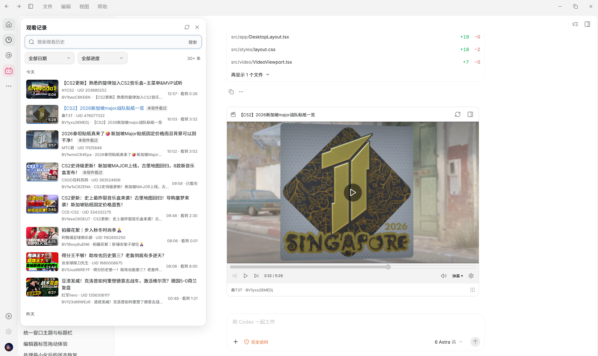
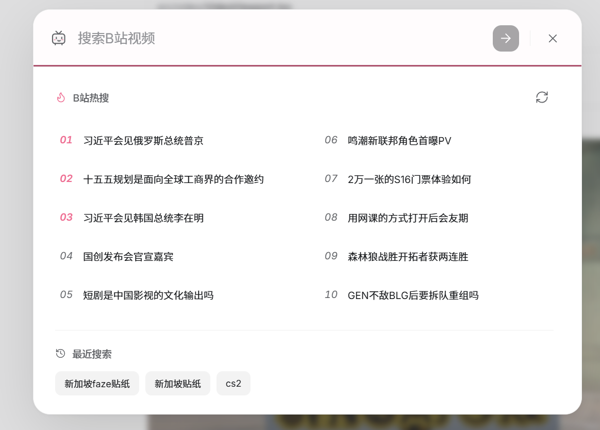
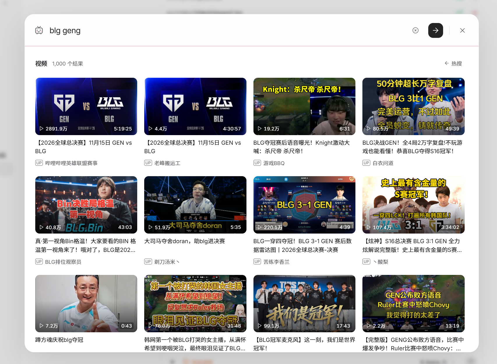
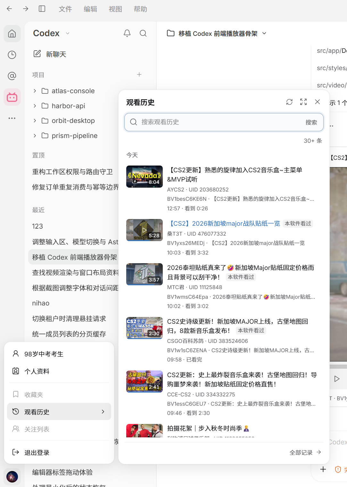

# Codex Bilibili Player

在 Codex 风格的桌面工作区里看 B 站视频。

做这个项目的想法很简单：把 B 站播放器放进熟悉的聊天与分栏布局里。视频可以嵌在对话中，也可以移到右侧继续播放；搜索、观看记录和播放进度都围绕这个体验来做。

项目使用 **Electron + React + TypeScript**，目前提供 **Windows x64** 便携版。B 站账号、搜索和播放接入真实服务，聊天与开发工作区使用本地演示场景。

[下载 v1.3.3](https://github.com/78percent/Codex_Bilibili_Player/releases/tag/v1.3.3) · [版本记录](docs/releases/1.3.3.md) · [从源码运行](#从源码运行)



## 直接使用

在 [Release](https://github.com/78percent/Codex_Bilibili_Player/releases/tag/v1.3.3) 下载 `Codex-Bilibili-Player-1.3.3-x64.exe`，双击即可启动，无需安装 Node.js 或其他开发工具。首次启动会解压运行文件，稍候即可。

- 点击左侧粉色小电视，搜索并选择视频。
- 点击左下角头像登录 B 站。支持应用内扫码，密码和短信登录会打开 B 站官方窗口；播放前会检查账号的手机号绑定状态。
- 点击左侧时钟查看观看记录，或从头像菜单打开快捷历史卡片。

当前版本为预发布版，EXE 尚未签名，Windows 可能显示 SmartScreen 提示。下载页附有 `SHA256SUMS.txt`，可用于核对文件。

## 搜索视频

打开搜索框就能看到 B 站热搜和最近搜索。输入时显示联想，修改关键词会保留面板和上一批结果，等待新的内容补上。搜索框里的小电视会眨眼，请求时变为粉色。



搜索结果按卡片展示封面、标题、UP 主、播放量和时长，选中后就在当前对话里播放。



## 找回上次看到的视频

观看记录有两个入口：头像菜单里的快捷卡片适合随手找一条，点到外面就能收起；侧栏时钟打开更宽的管理窗口，可以按日期和观看进度筛选。

历史搜索沿用 B 站的搜索方式，在这个播放器里看过的视频会带上“本软件看过”标记。点击记录回到播放器，接着上次的进度看。



## 播放与布局

聊天内的视频卡片可以拖动缩放，也可以切换到右侧窗口。两个位置共用同一个播放会话，切换布局时继续播放。重新打开应用后，会恢复上次的视频和进度，等待点击播放。

- **播放控制**：进度、音量、清晰度、五档倍速，以及推荐队列切换。
- **字幕与弹幕**：字幕轨道和样式、弹幕显示参数与屏蔽词。
- **布局记忆**：保留视频卡片尺寸、分栏宽度和放大状态。
- **快捷操作**：点击画面暂停，滚轮调整音量；播放器获得焦点后，Space / Enter 播放或暂停，方向键快进和调音量，M 静音，D 切换弹幕。

## 从源码运行

准备 **Windows x64、Node.js 24 LTS 和 Git**，在 PowerShell 中执行：

```powershell
git clone https://github.com/78percent/Codex_Bilibili_Player.git
cd Codex_Bilibili_Player
npm ci
.\Start-Development.cmd
```

`npm ci` 会安装 Electron 运行时。启动脚本会打开 Vite 和 Electron，重复启动时唤回已有窗口，并处理本项目遗留的开发服务。关闭窗口后，开发服务随之退出。

只调整网页布局时可以使用 `npm run dev`；账号和视频功能通过 Electron 主进程提供，开发这些功能时使用上面的完整启动入口。

### 构建便携版

```powershell
# 构建前端，输出到 dist/
npm run build

# 生成 Windows x64 便携 EXE，输出到 release/
$env:ELECTRON_BUILDER_CACHE = "$PWD\.cache\electron-builder"
$env:CSC_IDENTITY_AUTO_DISCOVERY = "false"
npm run package
```

### 代码组织

界面按功能拆分，B 站接口集中在主进程，场景数据与 UI 分开维护。

| 目录 | 内容 |
| --- | --- |
| `electron/bilibili/` | 账号、搜索、历史、字幕弹幕与媒体中转 |
| `electron/` | 桌面窗口、应用生命周期和 IPC 桥接 |
| `src/features/video/` | 播放会话、聊天内卡片与右侧播放器 |
| `src/features/video-search/` | 搜索窗口、联想与结果卡片 |
| `src/features/history/` | 观看记录窗口与快捷卡片 |
| `src/features/account/` | 登录、头像菜单与个人资料 |
| `src/app/`、`src/components/ui/` | 工作区外壳与公共控件 |
| `src/state/`、`src/scenarios/` | 状态持久化与本地演示数据 |
| `src/styles/` | 界面样式 |

### 本地数据

开发版数据位于 `%APPDATA%\CodexBilibiliPlayer-Dev`，便携版位于 `%APPDATA%\CodexBilibiliPlayer`，开发启动日志位于 `.runtime/integration/`。

B 站会话通过 Electron safeStorage 加密保存；观看历史、搜索词和聊天内容保存在本机 localStorage，历史与搜索按账号区分。播放时向 B 站同步观看进度，退出账号或删除 EXE 后本地记录仍会保留。

## 相关项目与资料

- [dash.js](https://github.com/Dash-Industry-Forum/dash.js)：DASH 音视频播放。
- [bilibili-api-collect](https://github.com/bilibili-plugins/bilibili-api-collect)：B 站社区接口参考。
- [B 站接入设计](openspec/changes/connect-bilibili-playback/design.md)、[播放器控件记录](openspec/changes/explore-player-controls/implementation.md)。
- [设计与资源来源](docs/sources.md)：界面参考、图标和字体来源。

这是个人开发的非官方项目。字体许可证随 `public/fonts/` 保留，其他资源的来源与权利说明见上面的资源文档；项目自有代码的许可证尚未选定。
